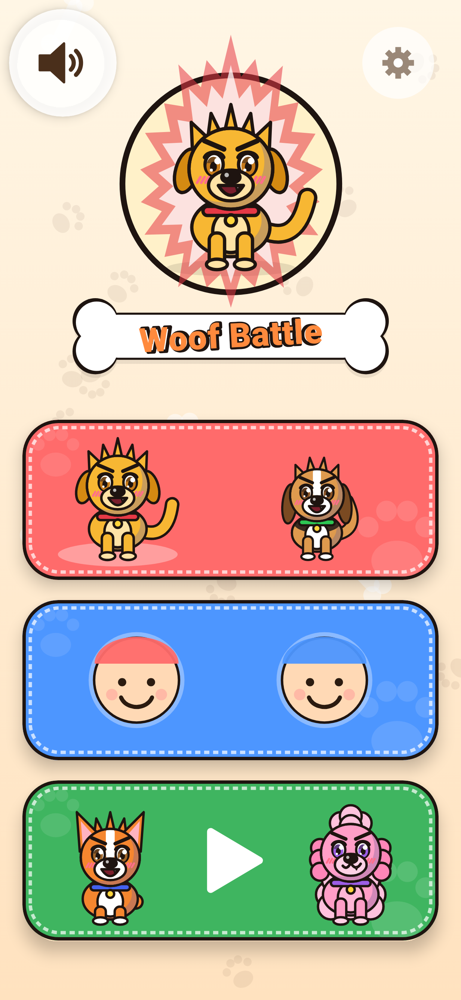
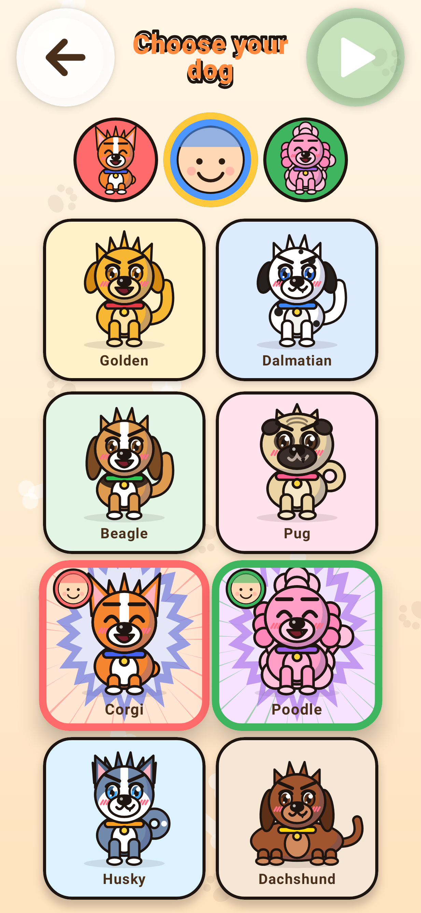
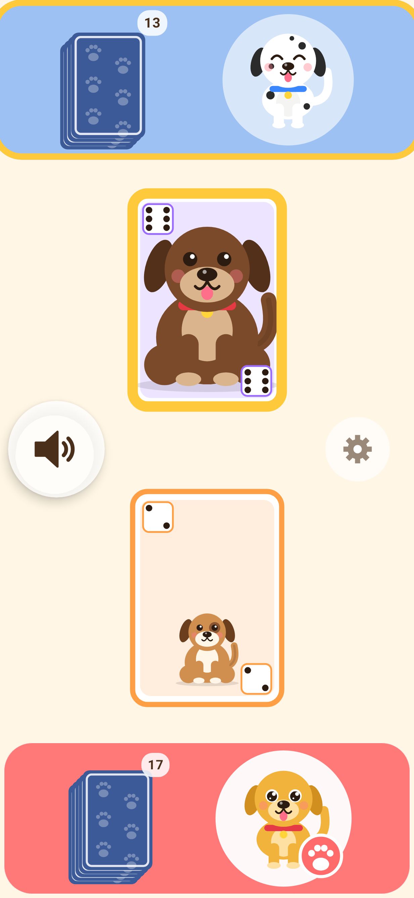
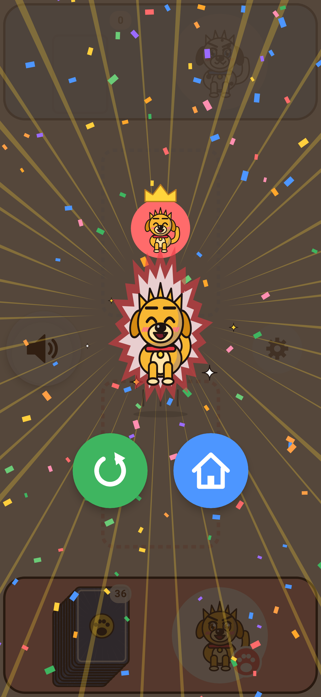
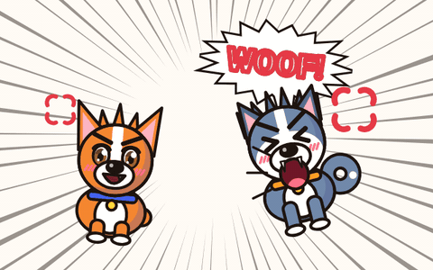
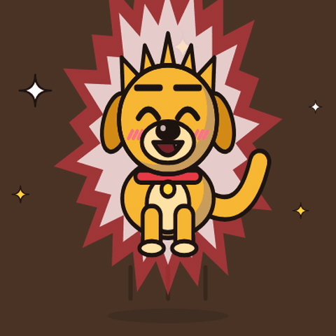
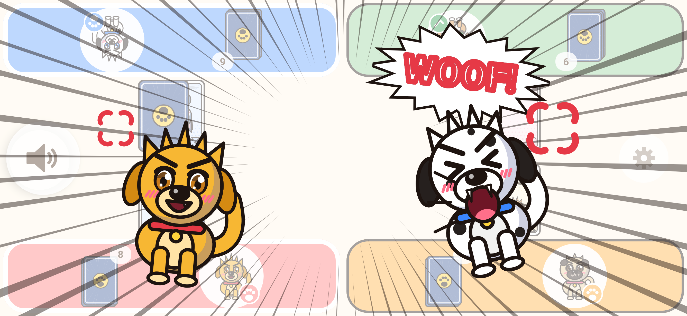
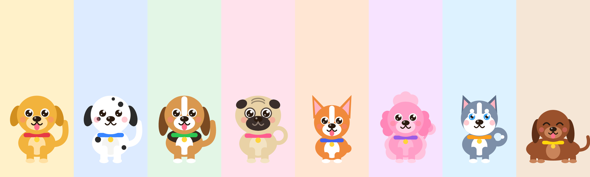

# Woof Battle

An offline card game for toddlers (3–6) based on the classic "battle" card game, with dogs.
Nobody needs to read or count: the bigger dog wins.

- 36 cards, values 1–6 (6 of each). Each card shows one dog drawn bigger as the value grows,
  plus dice-style pips in two corners.
- **8 caricatured breeds** to choose as "my dog" (6 of them also star on the 1–6 cards), all
  drawn in code (Compose Canvas). No image, icon or audio files.
- **Manga art style** (original, inspired by shōnen action anime; no characters, names or logos
  from any franchise): bold ink outlines, cel shading, spiky flame-like fur, big shiny anime eyes
  with determined brows, grins with a little fang, hatched blush, power auras, speed lines,
  halftone screentone and comic-impact "WOOF!" lettering.
- Sounds are synthesized at runtime (original, no third-party audio). There are three sound styles to choose from: little pup, big dog and silly cartoon.
- No INTERNET permission, no ads, no analytics, no purchases, no data collection.

<p>
  
  
  
  
</p>
<p>
  
  
</p>



## Build

Requirements: **JDK 17+** (tested with JDK 21) and an Android SDK with **Platform 37**
(Build-Tools 37 is downloaded by AGP automatically once the SDK license is accepted).

Point Gradle at the SDK with either `ANDROID_HOME` or a `local.properties` file:

```properties
sdk.dir=C:/Users/you/AppData/Local/Android/Sdk
```

Then:

```bash
./gradlew assembleDebug     # APK: app/build/outputs/apk/debug/app-debug.apk
./gradlew test              # engine rules + app unit tests + end-to-end UI flows (Robolectric)
```

On Windows use `gradlew.bat` (or `./gradlew` from Git Bash).

Optional: render the main screens to PNG without a device (Robolectric native graphics).
Output goes to `app/build/screenshots/`:

```bash
./gradlew :app:testDebugUnitTest -Pscreenshots
```

## Install

```bash
adb install -r app/build/outputs/apk/debug/app-debug.apk
```

## Project structure

```
WoofBattle/
├── engine/                     Pure Kotlin/JVM module, no Android dependencies
│   └── src/main/kotlin/com/woofbattle/engine/
│       ├── Model.kt            Card, Player, GameConfig, GameState, GameStatus, RoundEvent
│       ├── GameEngine.kt       Dealing, playRound(), end conditions, JSON codec
│       └── SeededRng.kt        SplitMix64: deterministic, seedable, state is one Long
│   └── src/test/…/GameEngineTest.kt   24 rule and edge-case tests
├── app/                        Android app (Kotlin, Jetpack Compose, Material 3, MVVM)
│   └── src/main/java/com/woofbattle/app/
│       ├── MainActivity.kt     Single activity, immersive, keeps screen on
│       ├── GameViewModel.kt    Round flow, animation timeline, SavedStateHandle persistence
│       ├── Settings.kt         Parent settings (SharedPreferences) + EN/FR/ES/NL labels
│       ├── SoundPlayer.kt      Synthesized SFX via SoundPool
│       └── ui/
│           ├── GameScreen.kt   Seats, flip zones, flying cards, WOOF banner, shake
│           ├── HomeScreen.kt   Mode tiles (vs dogs / together / demo)
│           ├── ParentArea.kt   Settings behind the 3-second hold gate
│           ├── Victory.kt      Confetti + happy dog
│           ├── DogArt.kt       The 6 dogs, card faces, card backs, paw prints
│           ├── Icons.kt        Canvas icons (house, replay, speaker, gear…)
│           └── Components.kt   Theme, big buttons, parent gate, PlayingCard, PileStack
└── gradle/libs.versions.toml   AGP 9.4.1, Kotlin 2.4.21, Compose BOM 2026.09.00
```

The engine is a pure function: `GameEngine.playRound(state)` returns the next state plus a
list of `RoundEvent`s (Reveal, WoofBattle, FaceDown, Forfeit, Collect, Returned, Eliminated,
GameOver). The ViewModel replays those events as animations. The RNG state is stored in
`GameState`, so a saved game continues exactly as it would have.

## Rules (as implemented)

1. 2–4 players. Every new game (and every replay) shuffles the 36 cards with a fresh random
   seed and deals them evenly (18 / 12 / 9 each), face down. A short shuffle animation plays first.
2. Everyone still in the game flips their top card at the same time.
3. Highest card wins. The winner takes all the flipped cards, shuffled, to the bottom of their pile.
4. Tie for highest → **WOOF BATTLE!** Only the tied players each put one card face down, then
   one face up. The highest new card wins *everything* on the table. Ties repeat.
5. Edge cases:
   - A tied player with only one card left plays it face up (no hidden card).
   - A tied player with no cards loses the battle. If only one tied player can continue,
     they win the table.
   - If *no* tied player can continue, every player takes back the cards they put down
     (shuffled, to the bottom). This is a rare draw round.
   - A player with 0 cards after a round is eliminated.
   - **Classic game** ends when one player holds all cards.
   - **Short game** (parent setting: 10 / 20 / 30 rounds, default 20) ends after N rounds.
     Most cards wins, and a tie for most cards means shared victory.
   - **Safety cap:** at 500 rounds the game ends and most cards wins.

## Modes and UX

**Flow:** the app opens on the menu. Pick a game type (red = against dogs, blue = together),
then how many play. **Choose your dog** follows, with one coloured slot per human player:
1 slot against the computer, 2–4 slots for children sharing the phone. The slot with the gold
ring is choosing; tapping a dog gives it to that player (it barks and gets the player's colour)
and moves on to the next player. **A dog already taken by another player can't be chosen.**
Tap a player's slot to change their dog. The green play button starts the game once every player
has a dog; Back returns to the menu. The demo has no human players, so it starts straight away.

**Dog-park menu:** the home screen has a warm background with paw prints and bones, the title on
a bone-shaped plate, and stitched tiles. The dog player 1 chose last time sits at the top.
Each breed is a caricature in its own colour:

| Breed | Colour / look |
|---|---|
| Golden Retriever | golden, floppy ears, tongue out |
| Dalmatian | white with black spots |
| Beagle | tan with dark saddle, long ears |
| Pug | fawn with black mask, curly tail |
| Corgi | orange, giant pointy ears, short legs |
| Poodle | pink and fluffy, pompom tail |
| Husky | blue-grey, white mask, blue eyes |
| Dachshund | chocolate, long "sausage" body |

Each chosen dog is that player's seat avatar in the game and on the victory screen. Computer
dogs get different breeds, picked at random for each game. Replay keeps everyone's dog.

Tapping the red or blue tile opens a picker with three big picture tiles (a small corner
label is there for parents). The arrow button or Back returns to the menu.

- **Vs dogs** (red tile): one child (bottom seat) against **1, 2 or 3** computer dogs. "1 vs 1"
  is a plain two-player game against the computer. The computer just flips and has no strategy.
- **Together** (blue tile): **2, 3 or 4** children share one phone or tablet. Each seat has a big
  coloured flip zone at its own edge. In portrait and 2×2 layouts the far seats are rotated
  180° so players across the table see their cards upright. The round starts when everyone has tapped.
- **Demo** (green tile): all seats play automatically. The parent area also has an
  **auto-play** toggle that works in any mode.
- **Tap to continue:** after every round the cards stay on the table, with the winning card
  highlighted and a pulsing paw in the middle, until someone taps anywhere on the screen. Then
  the cards slide to the winner and the next round can start. Demo, auto-play and games with only
  computer dogs left continue on their own after a short pause.
- The pile is drawn as a stack whose height grows with card count, plus a small number for parents.
- Tie: bark sound, screen shake and an animated manga **bark-off**: the tied dogs lunge at each
  other and take turns shouting "WOOF!" (OUAF ! / ¡GUAU! / WOEF!) in jagged speech balloons, with
  anger marks and speed lines.
- Victory: confetti, turning gold rays, winner badge with crown and an animated manga **jump**:
  the winner dog squashes, springs up with a power aura, lands in dust puffs among sparkles.
- **Parent area:** hold the gear button for 3 seconds (a ring fills up). It sets the number of
  players in the demo (the other modes choose it on their picker), game
  length, sound on/off, **sound style** (tap a style to hear its bark), auto-play and
  **language**: English, Français, Español, Nederlands, and lets you quit a game.
- Every child-facing touch target is at least 96dp. Everything is tap-only, with no swipe gestures.
- The system Back button is ignored during a game so toddlers don't exit by accident.

## Persistence

- Rotation: the ViewModel survives. Process death: the session (mode, human seats, full engine
  state including RNG) is saved as JSON in `SavedStateHandle` *before* each round animates.
  A restored game resumes at the start of the next round.
- Settings are stored in SharedPreferences, excluded from cloud backup and device transfer.

## Assumptions

- **Draw round:** if every tied player runs out of cards, nobody wins the table and each player
  takes back their own cards. This case is unspecified in classic rules.
- **Short game / cap tie:** several players with the same top card count are all shown as winners.
- The child is always seat 0 (bottom, red) in "vs dogs" mode.
- Player-count and game-length changes apply to the next game, not the one in progress.
- The parent gate is a 3-second hold. It is a deterrent for toddlers, not a security barrier.
- Labels outside the parent area are limited to "WOOF!" and the title. Parents read the small
  card count. Children compare stack heights and dog sizes.

## Known limitations

- Verified with unit tests and Robolectric-rendered screenshots only. It has not yet been run on
  a physical device or emulator, so check animation timing, audio and touch feel on real hardware.
- Synthesized sounds are simple, cartoonish tones. Drop CC0 WAVs into the `SoundPlayer` if you
  want richer audio.
- Mid-round process death resumes at the start of the next round. The round is already decided
  and saved, but its animation isn't replayed.
- The release build is minified but unsigned. Add a signing config for distribution.
- No TalkBack-optimised flow beyond content descriptions on buttons.
